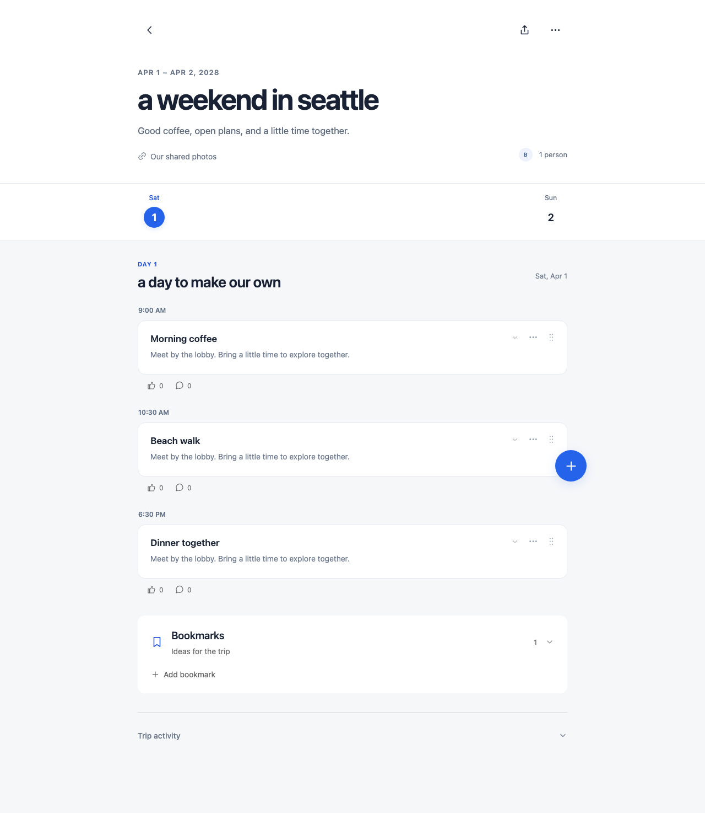
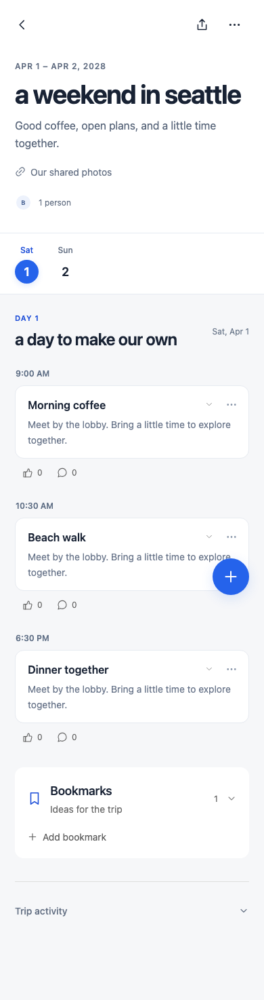
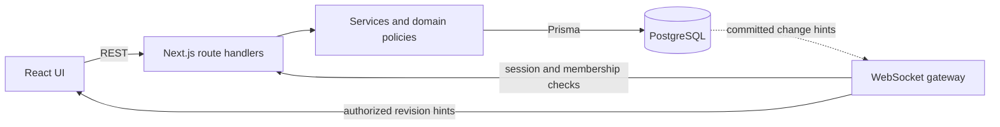

# itinerary

A shared workspace for planning group trips. Collect ideas, build a daily itinerary, and make plans together without losing everything in a group chat.



<details>
<summary>Mobile view</summary>



</details>

## Features

- Create trips with dates, an IANA timezone, a description, and shared links.
- Invite friends by email or share a read-only invitation link. Manage owner, editor, and viewer access.
- Save bookmarks with optional links and notes, organize them into collections, and filter saved ideas.
- Schedule activities by day, reorder them with drag-and-drop or keyboard controls, and add bookmarks to the itinerary without removing the original idea.
- Discuss activities and bookmarks, vote on ideas, and browse trip history.
- See itinerary changes from other members without refreshing. Reconnects load the latest plan; concurrent edits retain drafts and require review.
- Use the app on desktop, tablet, and mobile layouts.

## Stack

| Area                   | Tools                                                    |
| ---------------------- | -------------------------------------------------------- |
| UI                     | Next.js, React, TypeScript                               |
| API and authentication | REST route handlers, Zod, Better Auth, database sessions |
| Data                   | PostgreSQL, Prisma, versioned SQL migrations             |
| Realtime               | WebSockets (`ws`), PostgreSQL LISTEN/NOTIFY              |
| Development and CI     | Docker Compose, ESLint, Prettier, GitHub Actions         |
| Testing                | Vitest, Playwright, PostgreSQL integration tests         |

## Local setup

Requires **Node.js 24**, npm, Docker with Compose v2, and an SMTP provider or local email catcher for email signup and password recovery. Google sign-in is optional.

```sh
npm ci
cp .env.example .env
```

Fill in `.env` before starting the application:

| Variable                                                             | Description                                                                             |
| -------------------------------------------------------------------- | --------------------------------------------------------------------------------------- |
| `POSTGRES_USER`, `POSTGRES_DB`                                       | Local Docker database role and database name. Defaults are in the template.             |
| `POSTGRES_PASSWORD`                                                  | Choose a local password.                                                                |
| `DATABASE_URL`                                                       | PostgreSQL connection URL using the same role, database, and URL-encoded password.      |
| `BETTER_AUTH_SECRET`                                                 | Random session secret, at least 32 characters. Generate with `openssl rand -base64 32`. |
| `BETTER_AUTH_URL`                                                    | Application origin; `http://localhost:3000` locally.                                    |
| `SMTP_HOST`, `SMTP_PORT`, `SMTP_USER`, `SMTP_PASSWORD`, `EMAIL_FROM` | Email server and sender settings. Local email catchers can omit SMTP authentication.    |
| `GOOGLE_CLIENT_ID`, `GOOGLE_CLIENT_SECRET`                           | Optional Google OAuth web application credentials.                                      |

For Google OAuth, register `http://localhost:3000/api/auth/callback/google` as an authorized redirect URI. Configure the corresponding HTTPS callback when deploying. SMTP port 465 uses implicit TLS; production connections on other ports require STARTTLS.

```sh
docker compose up -d --wait
npm run db:deploy
npm run db:generate
npm run dev
```

Open **http://localhost:3000**. Sign up, verify your email, and create a trip. To try collaboration, invite a second account and open the trip in another browser profile.

The application runs on the host; PostgreSQL runs in Docker. Local defaults use ports 3000 and 5432. The database volume persists across restarts. `docker compose down` stops it without deleting data; adding `-v` deletes the volume. Keep `.env` out of version control.

To run the production build locally:

```sh
npm run build
npm start
```

## Architecture

One application serves the UI, REST API, and WebSocket connections. Business rules live in services and domain policies, with PostgreSQL as the source of truth.



Writes use validated REST requests, server-side permissions, transactions, and revision checks. WebSocket messages carry revision hints; clients fetch an authorized snapshot rather than applying unverified edits. PostgreSQL notifications are emitted after commit. Reconnects and periodic authorization checks recover missed updates and revoke access when membership or sessions end.

See [ARCHITECTURE.md](ARCHITECTURE.md) for database constraints, concurrency handling, and deployment tradeoffs.

## API overview

| Resource                   | Endpoints                                                                  |
| -------------------------- | -------------------------------------------------------------------------- |
| Authentication             | `/api/auth/*`                                                              |
| Trips                      | `GET/POST /api/trips`, `GET/PATCH/DELETE /api/trips/:tripId`               |
| Membership and invitations | `POST /api/trips/:tripId/members`, `POST /api/trips/:tripId/invitations`   |
| Read-only sharing          | `POST/DELETE /api/trips/:tripId/read-link`, `POST /api/join/:token`        |
| Bookmarks and collections  | `/api/trips/:tripId/bookmarks`, `/api/trips/:tripId/collections`           |
| Itinerary                  | `/api/trips/:tripId/itinerary`, nested `/days` and `/activities` resources |
| Discussion and history     | `/api/trips/:tripId/comments`, `/votes`, `/activity`                       |
| Health and live state      | `GET /api/health`, `GET /api/trips/:tripId/live-state`                     |

Private endpoints require a session and trip membership. State-changing requests also require a matching Origin. Editing endpoints use revision fields to reject stale writes. Paginated lists return bounded pages and cursors. Errors use a consistent shape:

```json
{
  "error": {
    "code": "STALE_VERSION",
    "message": "This resource changed. Review the latest details before saving."
  }
}
```

## Testing

```sh
npm run format:check
npm run lint
npm run typecheck
npm test
npm run build
```

The unit suite covers permissions, input validation, date/time rules, and realtime message validation. Integration tests exercise real PostgreSQL transactions, resource isolation, stale writes, invitation handling, and WebSocket authorization. Playwright covers critical user flows and responsive layouts, including two-user live edits and draft preservation.

Run the API and browser suites against a **local or disposable test database** with migrations applied:

```sh
npx playwright install chromium
npm run test:integration
npm run test:e2e
```

The test harness starts an application server on port 3101 and captures email locally on port 2526. It creates and removes its own fixtures; it does not send external email. Do not run it against production data.

To test the built production server, including encrypted SMTP, run the following after `npm run build`. The OpenSSL CLI is required to generate a temporary test certificate.

```sh
ITINERARY_TEST_PRODUCTION=1 npm run test:e2e
```

GitHub Actions runs formatting, lint, typechecking, unit tests, migrations, database constraints, API/browser workflows in both server modes, and the production build. It uses disposable PostgreSQL and generated test secrets.

## Project structure

```text
src/app/                    UI and REST route handlers
src/domain/                 Validation, permissions, and scheduling rules
src/server/                 Application services, queries, auth, and email
src/infrastructure/realtime/ WebSocket connection lifecycle
prisma/                     Relational schema and SQL migrations
tests/                      Unit tests and database constraints
scripts/                    API and browser test harnesses
server.ts                   Shared HTTP/WebSocket entry point
```

## Current limitations

- Automatic live updates cover the itinerary. Bookmarks, comments, votes, and trip history use their existing refresh controls; presence is not implemented.
- Trip ranges are limited to 90 inclusive dates and 100 activities per day. Overnight time ranges and ambiguous/nonexistent daylight-saving times are rejected.
- Email delivery is synchronous. Durable retries, reservations, file uploads, search, and cloud deployment are not implemented.
- Deployment requires a persistent Node process, PostgreSQL, HTTPS, and a proxy that forwards WebSocket upgrades. The custom server must be packaged with the application; Next.js standalone output alone is insufficient.
- Automated email tests use local capture. Live OAuth/email-provider checks and physical-device testing require separate verification.
